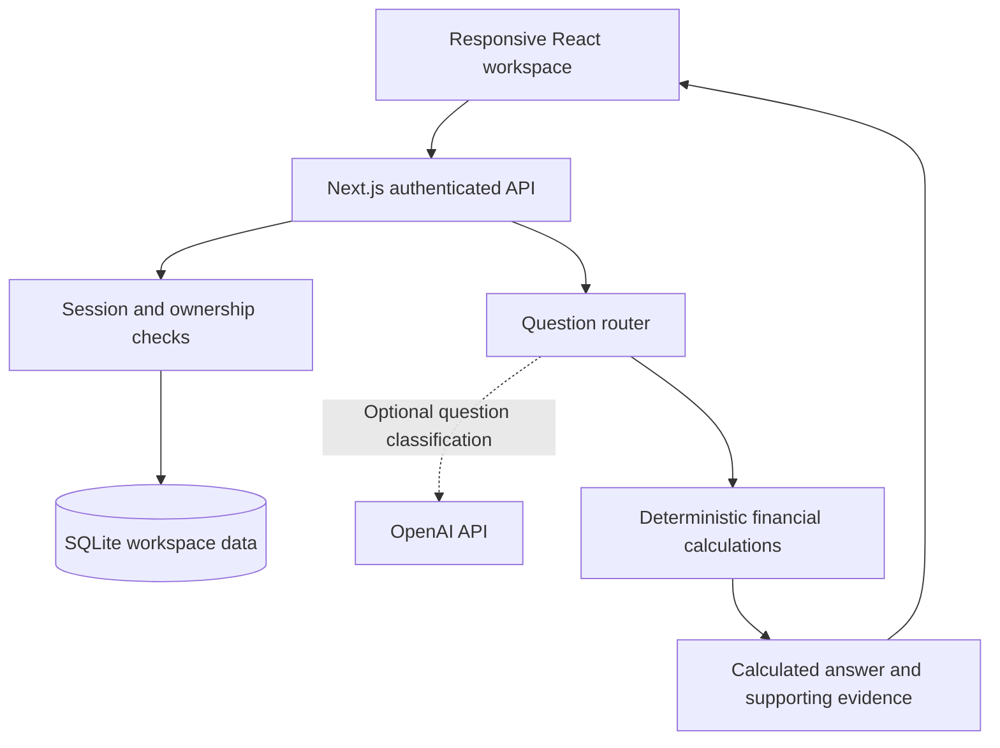

<a id="top"></a>

<div align="center">

# 🌿 Folio — AI Financial Assistant

**A little clarity for your money.**

Understand your spending, build a monthly plan, and move toward what matters—with financial answers you can trace back to your data.

[](https://github.com/khanadnann11-blip/financial-assistant/actions/workflows/ci.yml)
[](https://nodejs.org/)
[](https://nextjs.org/)
[](tsconfig.json)
[](LICENSE)

[Get started](#quick-start) · [Take the tour](#interactive-product-tour) · [Ask the assistant](#assistant-playbook) · [See what is next](#roadmap)

</div>

> **Project status: working MVP.** Folio supports isolated demo workspaces and registered accounts with manually maintained financial data. Live banking, scheduled notifications, password recovery, and production compliance operations remain on the roadmap. The application does not execute payments or trades.

## Explore this README

Use the links to jump to a topic. Expand the **▶ sections** for walkthroughs, technical details, and troubleshooting.

| Start using Folio                                     | Understand the system                         | Build and operate                             |
| ----------------------------------------------------- | --------------------------------------------- | --------------------------------------------- |
| [Quick start](#quick-start)                           | [Feature status](#feature-status)             | [Development commands](#development-commands) |
| [Interactive product tour](#interactive-product-tour) | [Financial rules](#financial-rules)           | [Testing and CI](#testing-and-ci)             |
| [Assistant playbook](#assistant-playbook)             | [Architecture](#architecture)                 | [Deployment](#deployment)                     |
| [Troubleshooting](#troubleshooting)                   | [Security and privacy](#security-and-privacy) | [Roadmap](#roadmap)                           |

## Why Folio?

Folio brings account snapshots, transactions, budgets, and goals into one personal workspace. The assistant helps explain that workspace with supporting metrics and source transactions.

Three principles shape the implementation:

1. **Calculate money in code.** Financial amounts come from deterministic calculations using integer cents.
2. **Make assumptions visible.** Manual balances, missing data, and forecasting assumptions are explained in the interface.
3. **Keep the assistant bounded.** Optional AI interprets a question; application code calculates and constructs the financial answer.

## Quick start

### Prerequisites

- **Node.js 24 or later**, including npm.
- Git to clone the repository.
- A writable local directory for SQLite data.
- An OpenAI API key only if you want optional AI question routing.

No separate database installation or bank credentials are required. SQLite comes from Node's built-in `node:sqlite` module, which may print an experimental warning depending on the Node release.

### Run locally

```bash
git clone https://github.com/khanadnann11-blip/financial-assistant.git
cd financial-assistant
npm ci
cp .env.example .env.local
npm run dev
```

Open **[http://localhost:3000](http://localhost:3000)**.

| Choose                    | What happens                                                                                              |
| ------------------------- | --------------------------------------------------------------------------------------------------------- |
| **Explore the demo**      | Creates an isolated workspace with sample accounts, budgets, goals, and up to six months of transactions. |
| **Create your workspace** | Registers an account and opens a blank workspace for your own manual entries.                             |
| **Sign in**               | Restores an existing registered workspace from the database.                                              |

Passwords must contain **12–128 characters**. Email verification and password recovery are not implemented yet. Demo transactions are dated relative to the current month and exclude future activity.

<details>
<summary><strong>Windows / PowerShell setup</strong></summary>

Run the same clone and install steps, replacing the copy command with:

```powershell
Copy-Item .env.example .env.local
npm run dev
```

The `npm test` script uses POSIX environment-variable syntax. Use WSL/Git Bash, or run the unit suite from PowerShell with:

```powershell
$env:DATABASE_PATH = ':memory:'
npx tsx --test tests/*.test.ts
Remove-Item Env:DATABASE_PATH
```

</details>

<details>
<summary><strong>Build and run production assets locally</strong></summary>

```bash
npm run build
npm start
```

This serves optimized assets; it does not provision hosting, TLS, or backups. Production session cookies use `Secure`, so a deployed application needs HTTPS. Browsers generally treat localhost as a special case.

For hosting, follow the [deployment section](#deployment) and [full operations guide](docs/DEPLOYMENT.md).

</details>

## Interactive product tour

Pick a workflow and expand it. The walkthroughs describe controls that exist in the current application.

<details open>
<summary><strong>1 · Get the big picture</strong></summary>

Start with **Explore the demo**, then open **Overview**.

- Review net account balance, posted income, net spending, and net cash flow.
- Change the month to explore another period.
- Compare the six-month income/spending chart and category breakdown.
- Open the budget check-in or recent transactions for more detail.
- Use a suggested question to move directly into the assistant.

**How to read it:** account totals are manual balance snapshots; income and spending reflect transactions in the selected month. These figures are maintained independently.

</details>

<details>
<summary><strong>2 · Record and find a transaction</strong></summary>

1. In a blank workspace, open **Accounts → Add account** first.
2. Open **Transactions → Add transaction**.
3. Enter a merchant, amount, direction, date, category, and existing account.
4. Save, then search for the merchant or filter by category and month.
5. Correct a category using its dropdown, or remove an entry with its delete control.

**Try it:** add a $12.34 coffee purchase as **Money out → Dining**. Ask the assistant about dining spending, then expand the supporting data.

A positive refund belongs to the original spending category. A payroll deposit belongs to **Income**. Recording activity does not update the account's manual balance snapshot.

</details>

<details>
<summary><strong>3 · Set a monthly spending rhythm</strong></summary>

Open **Budgets → Set budget**, choose a spending category, and enter a monthly limit.

- Category budgets repeat every month.
- Setting an existing category replaces its limit.
- Progress uses posted transactions in the selected month.
- The in-app notification panel flags categories above 80% of their limit.
- Unbudgeted categories do not enter the combined budget total.

**Try it:** set a Dining budget, add a dining transaction, and return to Budgets. Ask “How are my budgets?” to get a calculated check-in.

These are in-app checks, not scheduled email or push notifications.

</details>

<details>
<summary><strong>4 · Turn a goal into a monthly contribution</strong></summary>

Open **Goals → New goal**. Add a name, target amount, saved amount, and deadline.

Folio shows progress and the monthly contribution needed to close the remaining gap. Use **Update saved amount** to replace the total saved so far, including previous contributions.

**Try it:** create a $1,000 goal with $100 already saved and a future deadline, then ask “How much should I save for my goals?”

Goals are manual tracking records. Updating one does not transfer money or change an account balance.

</details>

<details>
<summary><strong>5 · Inspect, export, or delete your data</strong></summary>

Open **Settings & privacy** to inspect the workspace mode, currency, assistant configuration, and data update time.

- **Export my data** downloads account snapshots, transactions, budgets, and goals as JSON.
- **Delete my workspace** requires typing `DELETE` before removing the user and financial records from the active database.
- Sign out to revoke the current session and clear the displayed conversation.

Chats are held in client memory and are not saved to the application database. Operator backups and storage history have separate retention considerations; see [security and privacy](#security-and-privacy).

</details>

## Feature status

| Capability                    | Status                | Current behavior                                                                          |
| ----------------------------- | --------------------- | ----------------------------------------------------------------------------------------- |
| Financial dashboard           | ✅ Implemented        | Month selection, category breakdown, six-month cash-flow chart, budget and goal summaries |
| Authentication                | ✅ MVP                | Email/password, salted scrypt hashes, revocable seven-day sessions                        |
| Workspace isolation           | ✅ Implemented        | Financial operations derive the user from the server-side session                         |
| Transaction management        | ✅ Implemented        | Manual entry, search, filters, recategorization, deletion                                 |
| Budgets                       | ✅ Implemented        | Repeating monthly category limits with in-app checks                                      |
| Savings goals                 | ✅ Implemented        | Targets, saved totals, deadlines, contribution calculations                               |
| Account tracking              | ✅ Manual             | Checking, savings, and credit balance snapshots                                           |
| Cash-flow forecast            | ✅ Basic scenario     | Current-month spending-rate extrapolation with explicit assumptions                       |
| Financial assistant           | ✅ Implemented        | Local question routing, calculated answers, supporting metrics and transactions           |
| OpenAI integration            | ⚙️ Optional           | Broader question classification; requires a server-side API key                           |
| Data controls                 | ✅ Implemented        | JSON export and active-database workspace deletion                                        |
| Mobile interface              | ✅ Implemented        | Responsive navigation, forms, cards, and scrollable transaction tables                    |
| Live banking                  | ⏳ Planned            | Provider consent, synchronization, reconciliation, and revocation                         |
| Recurring bills and income    | ⏳ Planned            | Detection, user confirmation, and due-date-aware forecasting                              |
| Email/push notifications      | ⏳ Planned            | Opt-in reminders and scheduled alerts                                                     |
| Password recovery and MFA     | ⏳ Planned            | Recovery, verified identity, and stronger account controls                                |
| Payments, trading, tax filing | Outside current scope | No financial execution or regulated advice workflow                                       |

## Assistant playbook

### Questions to try

| Want to understand…  | Ask…                                        |
| -------------------- | ------------------------------------------- |
| Overall spending     | “Where is my money going?”                  |
| A category           | “What did I spend on dining this month?”    |
| A comparison         | “Compare spending with last month”          |
| A specific period    | “What did I spend on groceries in 2026-10?” |
| Recorded income      | “What is my income this month?”             |
| Budget progress      | “How are my budgets?”                       |
| Goal contributions   | “How much should I save for my goals?”      |
| Balance snapshots    | “What are my account balances?”             |
| A cash-flow scenario | “What is my cash-flow forecast?”            |
| Recent activity      | “Show recent transactions”                  |

Supported periods are **this month**, **last month**, and one explicit **`YYYY-MM`**. Forecasts support the current month only. Common unsupported windows, such as “last year,” prompt clarification. Use the Transactions screen for merchant-level searches.

Answers are independent requests rather than a persisted, context-aware conversation. Include the category and period in each question instead of relying on a previous message.

### Choose an assistant mode

|                         | Local mode                      | Optional AI routing                                        |
| ----------------------- | ------------------------------- | ---------------------------------------------------------- |
| Setup                   | Works immediately               | Set `OPENAI_API_KEY`                                       |
| Question interpretation | Supported local patterns        | Model classifies intent, category, and explicit month      |
| Financial calculations  | Local application code          | Local application code                                     |
| Final financial wording | Constructed by application code | Constructed by application code                            |
| External processing     | No model request                | Question text and classification instructions go to OpenAI |
| Failure behavior        | Local response or help          | Falls back to local routing on timeout or invalid output   |

<details>
<summary><strong>Enable optional OpenAI routing</strong></summary>

Edit `.env.local`:

```dotenv
OPENAI_API_KEY=your_server_side_api_key
OPENAI_MODEL=gpt-4.1-mini
```

Restart the server after changing configuration. Never commit an actual key or expose it through a `NEXT_PUBLIC_` variable.

The model receives the question and allowed classification schema. The application does not include account balances or transaction history in that request. Users can still disclose sensitive information in their own question text, so avoid account numbers and other identifiers.

Model output is validated with Zod. It cannot select another user, execute SQL, move money, or generate the final financial amounts. This integration is intent routing, not unrestricted generative financial advice.

</details>

<details>
<summary><strong>Trace an answer back to its evidence</strong></summary>

Expand **View supporting data** beneath an answer to inspect applicable metrics, period, workspace update time, and supporting transactions.

For spending questions, the assistant excludes transfers and pending entries and offsets spending with refunds. A zero result from an incomplete workspace does not establish that no spending happened elsewhere.

Source lists show up to 20 supporting transactions; the Transactions screen provides the full workspace history.

</details>

## Financial rules

All amounts are **USD integer cents** internally. The UI accepts dollar amounts and converts them to cents.

| Record           | Convention                               | Effect                                        |
| ---------------- | ---------------------------------------- | --------------------------------------------- |
| Expense          | Negative amount in a spending category   | Increases category spending                   |
| Refund           | Positive amount in the original category | Reduces category spending                     |
| Income           | Signed amount categorized as `Income`    | Enters income; negative corrections reduce it |
| Transfer         | Categorized as `Transfer`                | Excluded from income and spending             |
| Pending entry    | `pending: true`                          | Excluded from posted financial analytics      |
| Credit liability | Negative account balance                 | Reduces the recorded net account total        |
| Goal savings     | Manually recorded total                  | Does not allocate or move account funds       |

Analytics use UTC month boundaries. Account snapshots, transactions, and goal savings are separate records; automatic balance reconciliation is not implemented.

<details>
<summary><strong>Worked example: spending and net cash flow</strong></summary>

Suppose a month contains these posted transactions:

| Activity            | Category |     Amount |
| ------------------- | -------- | ---------: |
| Payroll             | Income   | +$5,000.00 |
| Restaurant purchase | Dining   |   −$100.00 |
| Restaurant refund   | Dining   |    +$25.00 |
| Savings transfer    | Transfer |   −$500.00 |

Folio calculates:

- **Income:** $5,000.00
- **Dining spending:** $75.00
- **Net recorded cash flow:** $4,925.00

The transfer is excluded. The refund reduces spending rather than becoming income. These are recorded activity totals, not a reconciled change in bank balances.

</details>

<details>
<summary><strong>How the cash-flow scenario works</strong></summary>

```text
Daily spending rate = current-month net posted spending / elapsed calendar days
Remaining expenses = daily spending rate × remaining calendar days
Projected balance  = manual checking balance − remaining expenses
```

The implementation floors the spending rate at zero if net spending is negative. Savings and credit balances are excluded. Future income is assumed to be zero; pending transactions are excluded.

For example, on day 15 of a 30-day month, $1,500 of spending gives a $100 daily rate. With a $4,000 checking snapshot and 15 days remaining, the projected balance is $2,500.

The displayed range varies remaining spending by ±25%. It is a **sensitivity scenario**, not a statistically calibrated confidence interval. This model does not schedule bills or payroll, and a large early-month expense can distort the estimate.

</details>

<details>
<summary><strong>How goal contributions work</strong></summary>

The remaining target is divided by the calendar-month difference to the deadline, using at least one month, and rounded up to the nearest cent. Completed goals require no further contribution.

This is a simple monthly target, not a daily schedule. The assistant calls out passed deadlines rather than promising an achievable plan.

</details>

## Architecture



The API loads financial records for the authenticated user before answering. OpenAI receives question text for classification only; it does not query the database.

| Layer             | Technology                      | Responsibility                                       |
| ----------------- | ------------------------------- | ---------------------------------------------------- |
| Application       | Next.js 16 App Router, React 19 | Interface and same-origin API                        |
| Language          | TypeScript, strict mode         | Shared financial types and checked interfaces        |
| Persistence       | Node SQLite                     | Users, financial documents, sessions, rate limits    |
| Validation        | Zod                             | API inputs and optional model output                 |
| Icons and styling | Lucide, CSS                     | Local SVGs and responsive layouts                    |
| Verification      | Node test runner, Playwright    | Financial/authentication tests and browser workflows |
| Automation        | GitHub Actions                  | Build, type checks, unit tests, browser tests        |

<details>
<summary><strong>Repository map</strong></summary>

```text
financial-assistant/
├── src/
│   ├── app/
│   │   ├── api/[...path]/route.ts  # Session-protected API and input validation
│   │   ├── globals.css            # Responsive design system
│   │   ├── layout.tsx             # Application metadata and root layout
│   │   └── page.tsx               # Workspace entry point
│   ├── components/
│   │   └── workspace.tsx          # Screens, forms, navigation, and chat
│   └── lib/
│       ├── assistant.ts           # Routing, calculated responses, and evidence
│       ├── finance.ts             # Spending, forecasts, and contribution math
│       ├── seed.ts                # Isolated relative-date demo records
│       ├── store.ts               # SQLite, passwords, sessions, atomic updates
│       └── types.ts               # Shared types, categories, and money formatting
├── tests/
│   ├── finance.test.ts
│   ├── store.test.ts
│   └── e2e/workspace.spec.ts
├── docs/
│   ├── ARCHITECTURE.md
│   ├── DEPLOYMENT.md
│   └── ROADMAP.md
├── .github/workflows/ci.yml
├── .env.example
└── playwright.config.ts
```

The current database stores each user's accounts, transactions, budgets, and goals as a financial JSON document. Updates use a SQLite transaction. Normalized PostgreSQL storage is a planned step before large-scale banking ingestion.

</details>

<details>
<summary><strong>API reference and a local example</strong></summary>

All paths below are prefixed with `/api`. Financial endpoints require a session. Mutations require an exact matching browser origin; deployments can configure `APP_ORIGIN`. Financial request bodies use integer cents.

| Method                | Path                  | Purpose                                       |
| --------------------- | --------------------- | --------------------------------------------- |
| POST                  | `/demo`               | Create an isolated demo session               |
| POST                  | `/register`, `/login` | Register or authenticate                      |
| POST                  | `/logout`             | Revoke the current session                    |
| GET                   | `/state`, `/export`   | Read or export the current workspace          |
| POST / PATCH          | `/accounts`           | Add an account or update its balance          |
| POST / PATCH / DELETE | `/transactions`       | Add, recategorize, or remove activity         |
| POST / DELETE         | `/budgets`            | Set or remove a category limit                |
| POST / PATCH / DELETE | `/goals`              | Create, update saved amount, or remove a goal |
| POST                  | `/assistant`          | Ask a question and receive evidence           |
| DELETE                | `/me`                 | Delete workspace after `DELETE` confirmation  |

With the development server running, try this from Bash:

```bash
mkdir -p work

# Cookie jar is local session material; work/ is excluded from Git.
curl --fail-with-body -c work/folio.cookies \
  -H 'Origin: http://localhost:3000' \
  -H 'Content-Type: application/json' \
  -d '{}' http://localhost:3000/api/demo

curl --fail-with-body -b work/folio.cookies \
  -H 'Origin: http://localhost:3000' \
  -H 'Content-Type: application/json' \
  -d '{"question":"How are my budgets?"}' \
  http://localhost:3000/api/assistant

# Revoke the session when finished.
curl --fail-with-body -b work/folio.cookies \
  -H 'Origin: http://localhost:3000' \
  -H 'Content-Type: application/json' \
  -d '{}' http://localhost:3000/api/logout
```

See [the route handler](src/app/api/%5B...path%5D/route.ts) for exact schemas, response codes, and limits, or [architecture notes](docs/ARCHITECTURE.md) for the data model.

</details>

## Configuration

Copy `.env.example` to `.env.local` for local development. Keep actual secrets out of source control.

| Variable         | Default                            | When to change it                                                   |
| ---------------- | ---------------------------------- | ------------------------------------------------------------------- |
| `DATABASE_PATH`  | `./data/finance.sqlite`            | Point to a writable persistent location when hosting                |
| `APP_ORIGIN`     | Request protocol and `Host` header | Set the exact public HTTPS origin behind a proxy; no trailing slash |
| `OPENAI_API_KEY` | Unset                              | Enable optional external question classification                    |
| `OPENAI_MODEL`   | `gpt-4.1-mini`                     | Choose an available model compatible with JSON output               |

Environment variables inherited from the process take precedence over `.env.local`. Production secrets belong in the hosting platform's secret configuration.

## Development commands

| Command                | Purpose                                                                      |
| ---------------------- | ---------------------------------------------------------------------------- |
| `npm ci`               | Install the lockfile's dependency versions                                   |
| `npm run dev`          | Start the development server on port 3000                                    |
| `npm run build`        | Create production assets and generate Next.js types                          |
| `npm start`            | Serve an existing production build                                           |
| `npm run typecheck`    | Check TypeScript types                                                       |
| `npm test`             | Run financial and store tests with an in-memory database; POSIX shell syntax |
| `npm run test:e2e`     | Run Chromium browser/API integration tests                                   |
| `npm run format:check` | Check formatting without writing files                                       |
| `npm run format`       | Apply Prettier formatting                                                    |

## Testing and CI

Run the main checks in this order on a fresh checkout:

```bash
npm ci
npm run build
npm run typecheck
npm test
npm run format:check
npx playwright install --with-deps chromium
npm run test:e2e
```

The browser installation step may require permission to install Linux system dependencies. The build generates Next.js route types used by type checking.

| Suite             | Current coverage                                                                                                                                                                           |
| ----------------- | ------------------------------------------------------------------------------------------------------------------------------------------------------------------------------------------ |
| Financial tests   | Refunds, signed income corrections, transfers, pending activity, cent arithmetic, forecasts, goal contributions, period handling, source evidence, invalid model routing fallback          |
| Store tests       | Password verification, isolated workspaces, revocable sessions, deletion, atomic rollback, rate limits                                                                                     |
| Browser/API tests | Demo tour, transaction creation/search, cited answers, goals, JSON export, mobile overflow/navigation, registration persistence, cross-user update rejection, cross-origin write rejection |

The initial MVP has **19 unit tests and four browser/API tests**. [GitHub Actions](https://github.com/khanadnann11-blip/financial-assistant/actions/workflows/ci.yml) runs the production build, type checks, unit suite, and Chromium suite on pushes and pull requests. The badge at the top shows the latest `main` workflow status.

<details>
<summary><strong>Browser test data and failure diagnostics</strong></summary>

Playwright launches a development server with `DATABASE_PATH=./work/e2e.sqlite`. Locally, it can reuse a server already running on port 3000; that server retains its own database configuration. Stop your normal development server first if you want the isolated test configuration.

Do not run integration tests against a workspace containing important data. Failure traces are saved under `test-results/` and uploaded by CI when a run fails.

```bash
npx playwright show-trace test-results/<failed-test>/trace.zip
```

The `work/`, `test-results/`, and database directories are ignored by Git. Unit tests do not need an OpenAI key; external routing fallback is tested with a mocked response.

</details>

## Security and privacy

| Implemented control                             | What it does                                                                          |
| ----------------------------------------------- | ------------------------------------------------------------------------------------- |
| Salted scrypt password hashes                   | Avoid storing plaintext passwords                                                     |
| Random session tokens stored as SHA-256 digests | Support server-side expiry and revocation                                             |
| HTTP-only, same-site cookies                    | Restrict client-script access; production cookies also use `Secure`                   |
| Server-side session ownership                   | Scope financial reads and writes to the authenticated user                            |
| Prepared SQL and Zod validation                 | Constrain database operations and request/model schemas                               |
| Origin checks and body limits                   | Reject mismatched mutation origins and oversized parsed bodies                        |
| Expiring rate limits                            | Throttle authentication, user requests, and assistant calls                           |
| Minimal error logging                           | Record endpoint/error metadata without intentionally logging financial request bodies |

<details>
<summary><strong>Data lifecycle and current limits</strong></summary>

- Financial data persists in SQLite; the application does not encrypt individual database columns.
- Sessions expire after seven days. Expired sessions and unused demo users are cleaned during a later authentication request, rather than by a scheduled worker.
- Chat is client memory only and disappears on reload or sign-out.
- Workspace deletion removes active user/financial records and cascades session deletion.
- SQLite page history, WAL files, hosting snapshots, and backups may retain older copies until handled under the operator's retention policy.
- Optional OpenAI routing sends question text to the provider; review its terms and retention controls before public use.
- The application has no bank access tokens, financial execution tools, or persisted conversation history.

Before handling production customer data, add verified identity/recovery, monitoring, operational retention/deletion procedures, independent security assessment, and launch-country legal review. The current content security policy permits inline Next.js scripts; nonce-based hardening remains a follow-up.

</details>

## Deployment

Use a **Node.js 24+ host with a persistent writable volume**, one application instance, and an HTTPS reverse proxy. An ephemeral serverless filesystem will not preserve this SQLite application's records reliably.

```dotenv
DATABASE_PATH=/app/data/finance.sqlite
APP_ORIGIN=https://finance.example.com
```

Then build and start the application:

```bash
npm ci
npm run build
npm start
```

Provision the volume, domain, HTTPS, secrets, and backups separately. The reverse proxy must overwrite untrusted `X-Forwarded-For` values, because authentication throttling uses that trusted client address. Restrict direct access to the application port.

For horizontal scaling, migrate to shared database storage and shared rate limiting first. Use an online SQLite backup mechanism or stop writes before copying data; copying only the main database file while WAL writes are active can produce an incomplete backup.

<details>
<summary><strong>Deployment readiness checklist</strong></summary>

This is an operator checklist, not a claim that the items are already provisioned. Copy it into your deployment issue and track completion there.

- [ ] Node.js 24+ runtime and reproducible `npm ci` installation
- [ ] Persistent writable database volume and restrictive filesystem permissions
- [ ] Exact public `APP_ORIGIN`, HTTPS, and secure session-cookie verification
- [ ] Trusted proxy headers and no public bypass to the application port
- [ ] Server-side secret configuration and provider retention review if AI is enabled
- [ ] Encrypted storage/backups, retention rules, and a tested restore procedure
- [ ] Scheduled cleanup, abuse controls, monitoring, and incident response
- [ ] Identity recovery, independent security review, and applicable legal/privacy review

</details>

Read [deployment and operations](docs/DEPLOYMENT.md) before exposing the app publicly. No hosted URL is configured by this repository itself.

## Roadmap

The checked items describe what exists in this repository. Unchecked items are planned work, not enabled capabilities.

### Delivered MVP

- [x] Responsive financial dashboard and isolated demo workspaces
- [x] Registered accounts, persistent data, and session-based access
- [x] Transactions, monthly budgets, savings goals, and manual balances
- [x] Basic cash-flow scenario with visible assumptions
- [x] Grounded assistant and optional AI question routing
- [x] Export/deletion controls, automated tests, and CI

### Next milestones

- [ ] **Host the app:** persistent storage, domain, HTTPS, backup and monitoring setup
- [ ] **Strengthen identity:** email verification, password recovery, MFA/passkeys, session management
- [ ] **Normalize storage:** PostgreSQL, migrations, per-record provenance, synchronization jobs
- [ ] **Connect banks:** one launch-country provider, hosted consent, signed webhooks, retries, reconciliation, revocation
- [ ] **Improve planning:** confirmed recurring bills/income, editable assumptions, historical forecast evaluation
- [ ] **Add opt-in notifications:** bill reminders and scheduled budget alerts
- [ ] **Expand assistance:** supported date ranges, merchant-level questions, educational content, broader evaluations
- [ ] **Prepare private beta:** security/accessibility review, retention verification, legal review, and a consented pilot

See the [detailed roadmap](docs/ROADMAP.md) for dependencies and completion gates. Payments, trading, underwriting, and individualized regulated advice require separate scope decisions.

## Troubleshooting

<details>
<summary><strong>“Unknown built-in module: node:sqlite” or SQLite import errors</strong></summary>

Check `node --version`. Use Node.js 24 or later in your terminal, build environment, and hosting runtime. Installing a separate SQLite server does not fix an unsupported Node runtime.

</details>

<details>
<summary><strong>“Invalid request origin” when saving or signing in</strong></summary>

Keep browser requests on one hostname and port. `localhost:3000` and `127.0.0.1:3000` are different origins.

For a proxy deployment, set `APP_ORIGIN` to the exact public HTTPS origin without a trailing slash, then restart the server. For a command-line mutation, supply the matching `Origin` header and keep the session cookie.

</details>

<details>
<summary><strong>Data disappears after restarting or redeploying</strong></summary>

Verify `DATABASE_PATH` and the process working directory. A relative path resolves from the directory where the server runs. In hosting, mount persistent storage and use an absolute database path. A new demo session creates a separate workspace; use a registered account for ongoing manual records.

</details>

<details>
<summary><strong>The assistant cannot answer a question or says AI routing is unavailable</strong></summary>

Try a supported question from the [playbook](#assistant-playbook), including an explicit category and period. Local mode works without an API key.

If you enabled OpenAI, check the server-side key, model access, and provider availability, then restart after configuration changes. Routing failures fall back to local patterns. Missing data and unsupported periods can still require clarification.

</details>

<details>
<summary><strong>Balances do not change after adding transactions or goal savings</strong></summary>

That is the current manual model. Update account balance snapshots under **Accounts** separately. Transactions drive activity analytics; goal savings track progress; neither automatically reconciles balances or moves funds.

</details>

<details>
<summary><strong>Browser tests cannot start, or type checking cannot find route types</strong></summary>

Run `npm run build` before type checking on a fresh checkout. Install the Chromium runtime with `npx playwright install --with-deps chromium`; Linux dependency installation may require elevated permissions.

Ensure port 3000 is free if you want Playwright to start its own isolated test server. Inspect `test-results/` traces for browser failures.

</details>

## Contributing and further reading

1. Read [AGENTS.md](AGENTS.md) and the relevant installed Next.js guides before changing application code.
2. Keep financial calculations in the domain layer and preserve per-user authorization on API changes.
3. Add meaningful regression coverage for changes to money, identity, or data isolation.
4. Run the relevant checks, format changes, and describe observable behavior in your pull request.

| Document                                                                  | Use it for                                                           |
| ------------------------------------------------------------------------- | -------------------------------------------------------------------- |
| [Architecture](docs/ARCHITECTURE.md)                                      | Storage design, API boundaries, and assistant trust model            |
| [Deployment](docs/DEPLOYMENT.md)                                          | Hosting requirements, environment variables, backups, and operations |
| [Roadmap](docs/ROADMAP.md)                                                | Remaining platform work and private-beta gates                       |
| [Issues](https://github.com/khanadnann11-blip/financial-assistant/issues) | Bug reports and scoped feature proposals                             |
| [MIT license](LICENSE)                                                    | Terms for using and modifying the project                            |

When reporting a financial calculation issue, include a minimal synthetic example and the expected result. Keep account numbers, credentials, and real financial exports out of public issues.

---

<div align="center">

**Small steps. Meaningful progress.**

[Back to top](#top)

</div>
